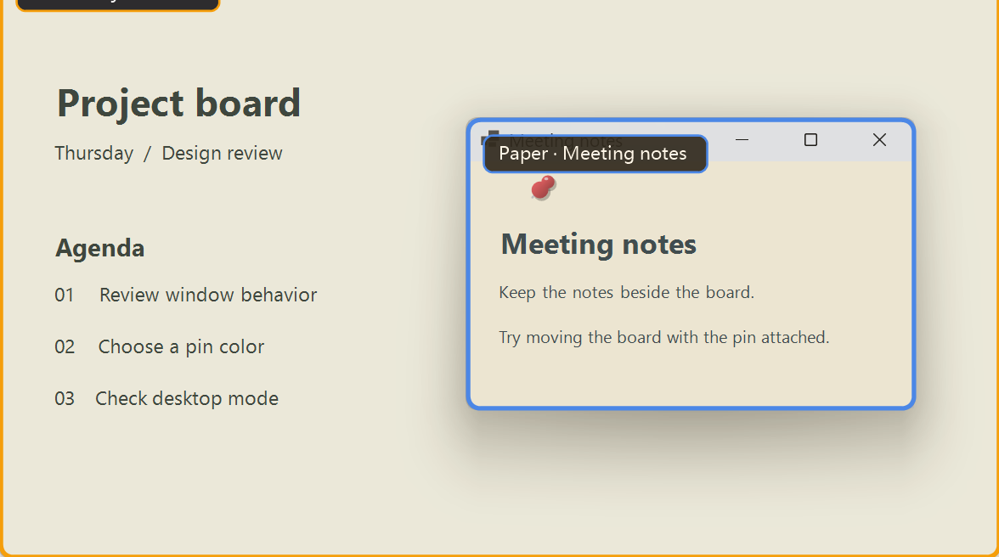

# 

<a href="README.md"></a> <a href="README.en.md"></a>

从图钉盒里拖出一颗图钉，松手的地方：**最上层的窗口是“纸”，它下面那个窗口是“墙”**（下面没有窗口就是桌面）。
之后只要两个窗口都在，激活其中任何一个，另一个都会一起出现，并保持“纸在墙上面”的层级。



## 运行

从 [Releases](https://github.com/Fr33-B1rd/Pin/releases/latest) 下载 `Pin.exe` 并双击运行。若从源码构建，双击 `publish\Pin.exe` 即可运行，所需的 .NET 桌面运行时已包含在发布文件中。

从源码运行或重新发布需要 .NET 10 SDK。下面的脚本优先使用 `%LOCALAPPDATA%\Programs\Pin-dotnet` 中的 SDK，也支持通过 PATH 使用系统安装的 SDK。

```bat
run.bat                 :: 等价于 dotnet run -c Release
publish.bat             :: 生成单文件 publish\Pin.exe
```

启动后右下角会出现一个**图钉盒**，托盘里有一个图钉图标。

## 操作

| 操作 | 效果 |
|---|---|
| 从图钉盒**拖出**图钉 → 松手 | 钉住：落点处最上层窗口 = 纸（蓝框），它下面的窗口 = 墙（橙框） |
| 落点下面没有别的窗口 | 钉在**桌面**：平时位于应用窗口下面；点击任务栏“显示桌面”时，仍显示在桌面上 |
| 拖到图钉盒上 / 拖到空白处松手 | 取消 |
| 拖动途中按 Esc 或右键 | 取消 |
| **单击**窗口上的图钉头 | 闪一下，显示它钉在哪 |
| **拖动**图钉头 | 拔出来：拖到别的窗口上 = 改钉；拖到空白处或图钉盒 = 拔掉 |
| **右键**图钉头 | 跟随墙移动 / 随墙最小化 / 拔出 |
| Ctrl + 拖动图钉盒 | 移动图钉盒 |
| 双击托盘图标 | 显示/隐藏图钉盒 |

支持**多级**（A 钉在 B 上，B 再钉在 C 上），结构是一棵树：一张纸只能钉在一面墙上，一面墙可以钉多张纸。会形成循环的钉法会被拒绝，并显示红框。

## 行为规则

- **激活树里任何一个窗口** → 整棵树一起浮到最上面，顺序为 墙 → 纸 → 纸上的纸。
- **墙最小化** → 纸跟着最小化；**墙还原** → 纸也还原。
- **纸被单独最小化后，再激活墙** → 纸会自动弹出（即“打开其中一个，另一个自动弹出”）。刚最小化的 0.8 秒内不会弹回。
- **墙移动** → 纸跟着平移，以墙的左上角为锚点。最大化和还原时不跟随，避免纸被甩出屏幕。
- **墙是置顶窗口** → 纸也会被设为置顶，拔出时恢复。
- **任一窗口关闭** → 这颗图钉自动拔出。

右键窗口上的图钉头，打开 **图钉颜色**，可为这颗图钉选择红、绿、蓝、黄。默认「跟随模式」：普通图钉为红色，桌面挂件为蓝色。手动选色后会保留到拔钉，也可以随时选回「跟随模式」。
 


### 可选的桌面挂件模式

先将窗口钉到桌面，再右键图钉头，勾选 **桌面挂件模式（隐藏独立任务栏入口）**。也可以右键图钉盒，在对应窗口的子菜单中切换。默认使用普通桌面绑定。

挂件随桌面一起出现，保留窗口的最小化按钮。钉住期间可能没有独立任务栏入口；可在桌面上点击窗口输入。再次点击菜单项可退回普通桌面绑定，拔钉或退出 Pin 也会解除挂件。已有所有者的窗口不支持此模式。

## 界面语言

右键托盘图标或图钉盒，打开 **语言 / Language**，可选「跟随系统」、简体中文或 English。切换立即生效并记住选择。

## 代码结构

```
src/
  Program.cs          单实例 + PerMonitorV2 DPI
  TrayContext.cs      托盘、菜单、组装
  PinManager.cs       ★ 核心：钉的关系树、SetWinEventHook 监听、层级堆叠 RaiseTree、跟随移动、最小化同步
  DragSession.cs      拖图钉：鼠标轮询、纸/墙判定、高亮、落钉
  PinDecal.cs         钉在窗口上的图钉头（点击/拔出/右键菜单）
  Dispenser.cs        图钉盒
  HighlightOverlay.cs 目标窗口描边
  LayeredWindow.cs    逐像素透明、永不抢焦点的窗口基类（UpdateLayeredWindow）
  PinArt.cs           图钉矢量绘制
  Win.cs / Native.cs  窗口查询与 Win32 P/Invoke
```

核心思路：关系保存在 `Dictionary<纸, Pin{墙}>` 里。全局监听这些事件：前台切换、最小化、位置变化、销毁、隐藏。
涉及某棵树时，按“墙在下、纸在上”的先序依次 `SetWindowPos(HWND_TOP, SWP_NOACTIVATE)`，只调整层级，不抢焦点。

## 已知限制（原型阶段）

- **以管理员身份运行的窗口**：普通权限的 Pin 动不了它们（UIPI），会弹提示。需要的话请以管理员身份运行 Pin。
- **只认当前会话中的窗口**：程序关掉重开，或 Pin 退出后，关系不会保留。下一步可以用“进程名 + 窗口类 + 标题”做持久化，等窗口重新出现时自动重新绑定。
- 用户点击时，Windows 会先把窗口提到最前，Pin 再把纸提上去，所以偶尔能看到一帧闪烁。
- 全屏独占的游戏，以及部分 UWP 的特殊窗口，可能管不了。
- 虚拟桌面之间切换时，图钉头靠 0.5 秒一次的巡检来同步，可能会有短暂延迟。

## 许可证

[MIT](LICENSE)
