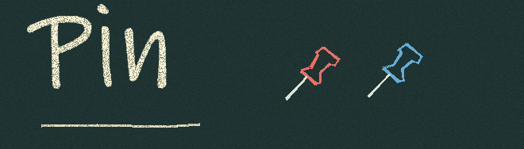
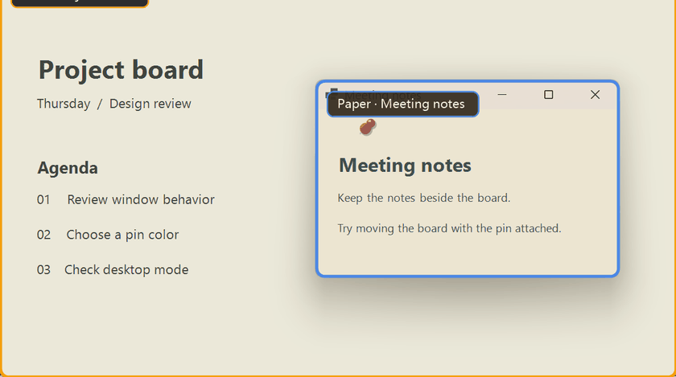
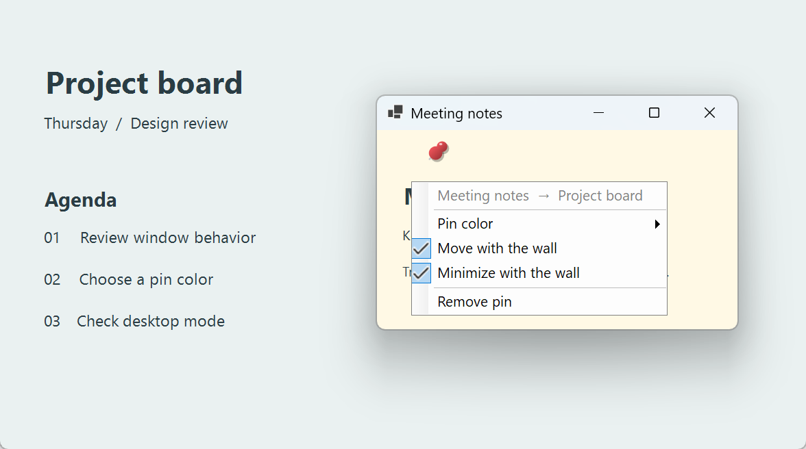

# 

 

**Keep your notes with the window you’re working in.**

Pin is a Windows utility that keeps one window above another. Pin your notes to VS Code, switch to your calendar, then click VS Code again. Your notes come forward with the editor, still on top of it. Other apps can cover both while you work elsewhere.

## Get started

[Download Pin.exe for Windows x64](https://github.com/Fr33-B1rd/Pin/releases/latest/download/Pin.exe) and double-click it. The .NET desktop runtime is included. Look for the pin box near the bottom-right corner of your screen.

1. Place a notes window partly over your editor.
2. Drag a pin from the box onto the overlap. Blue marks the front window (the **paper**). Amber marks the window underneath (the **wall**).
3. Release, switch to another app, then click the editor. Both windows come forward, with the notes above the editor.

## Ways to use Pin

- **Read and take notes.** Pin your notes to a browser. By default, moving or minimizing the browser carries the notes with it. Right-click the pin to change either setting.
- **Keep a set of tools together.** Attach a reference window and a checklist to the same editor, or pin a calculator to the checklist. Activating any member brings the group forward in order.
- **Keep a timer on the desktop.** Pin the timer to the desktop and press **Win+D** to see it. Enable desktop widget mode if you also want to hide its separate taskbar button.

## Language

Right-click either the tray icon or the pin box and open **语言 / Language**. The default, **Follow system**, uses Simplified Chinese for a Chinese Windows display language and English otherwise. Select **简体中文** or **English** to override it. Switching takes effect immediately and keeps your current pins in place. Pin remembers the language the next time you start it.

## Controls

| Action | Result |
| --- | --- |
| Drop a fresh pin on a window with only the desktop underneath | Attach that window to the desktop. |
| Press Esc or right-click while dragging | Cancel the drag. |
| Drop a fresh pin on empty space or back in the box | Return it unused. |
| Drag an attached pin head to another window | Reattach the pin at the new location. |
| Drop an attached pin on empty space or in the box | Remove the pin. |
| Right-click a pin head | Change its color, adjust how the paper follows its wall, or remove the pin. |
| Ctrl+drag the pin box | Move the box. |
| Double-click the tray icon | Show or hide the box. |
| Right-click the tray icon or the box | View pinned pairs, change the language, or exit. |

Under **Pin color**, choose red, green, blue, or yellow. **Use mode color** gives ordinary pins a red head and desktop widgets a blue head. A custom color lasts until you remove the pin or select **Use mode color** again.

## How pinned windows behave

Each paper can have one wall. A wall can hold several papers and can itself be pinned to another window. Activating any window in the group brings the group forward, with each paper above its wall. Pin rejects attachments that would form a loop.

By default, moving the wall moves its paper by the same distance. Maximizing or restoring the wall skips this movement. Minimizing and restoring the wall also minimizes and restores its paper. Right-click the pin head to change **Move with the wall** or **Minimize with the wall** individually. If you minimize the paper on its own, activating the wall can bring it back after a short grace period.

A paper attached to an always-on-top wall inherits that setting until you remove the pin. Closing either window removes its attachment. Exiting Pin releases all pins, so reattach the windows you need after a restart.

### Desktop widget mode

An ordinary desktop pin keeps its window below other apps and brings it into view with **Show desktop**. To use the window as a widget, right-click its pin head and select **Desktop widget mode (hide separate taskbar button)**. This option also appears under the window’s entry in the pin box menu.

You can click and type in the widget on the desktop. Its minimize button remains available, and its separate taskbar button may disappear. Select the option again to return to ordinary desktop pinning. Windows that already have an owner cannot use widget mode.

## Run or build from source

Install the .NET 10 SDK. The scripts first look in `%LOCALAPPDATA%\Programs\Pin-dotnet`, then use the SDK on your PATH. From the project directory, run `run.bat` to start Pin in Release mode or `publish.bat` to build the self-contained executable at `publish\Pin.exe`.

Window relationships and event handling live in `src/PinManager.cs`. For drag and drop, see `src/DragSession.cs`. For the attached pin head, see `src/PinDecal.cs`. The tray and pin box share menus through `src/TrayContext.cs`. Interface text and the language preference live in `src/UiText.cs`.

## Known limitations

- To pin a window running as administrator, start Pin as administrator too.
- Windows may briefly raise a wall before Pin puts its paper back above it, causing a visible flicker.
- Exclusive full-screen games and some UWP windows may not work with Pin.
- After you switch virtual desktops, a pin head may take about half a second to catch up.

## License

[MIT](LICENSE)
